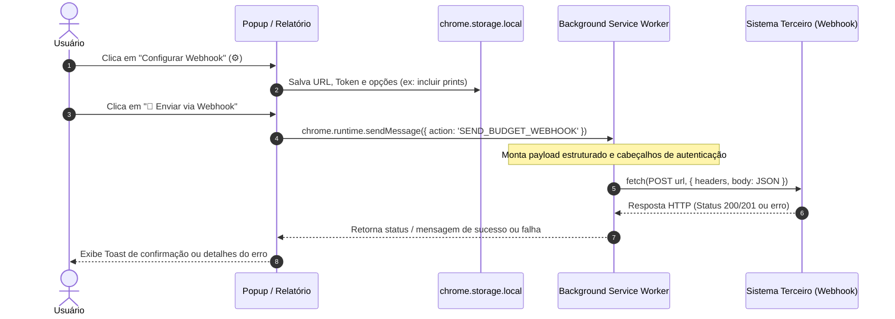

# Plano: Envio de Orçamentos via Webhook

## 1. Visão Geral e Objetivo

Permitir que o usuário envie os dados consolidados do orçamento ativo diretamente para sistemas externos (como **n8n, Make.com, Zapier, Webhook.site, Google Apps Script, ERPs ou APIs proprietárias**) através de uma requisição **HTTP POST (Webhook)**.

---

## 2. Arquitetura e Fluxo



> **Nota de Arquitetura**: O envio da requisição é delegado ao **Background Service Worker**. Isso garante que o envio não seja cancelado caso o usuário feche a janela popup durante a transmissão.

---

## 3. Especificação do Payload (Contrato JSON)

O payload enviado no corpo da requisição `POST` seguirá a seguinte estrutura:

```json
{
  "event": "budget.sent",
  "app": "CotaFácil",
  "version": "1.0.0",
  "sentAt": "2026-11-10T10:00:00.000Z",
  "budget": {
    "id": "budget-1731240000000",
    "name": "Reforma do Escritório",
    "createdAt": "2026-11-09T18:30:00.000Z",
    "totalItems": 3,
    "totalAmount": 1499.80,
    "items": [
      {
        "id": "item-1",
        "title": "Cadeira Ergonômica Presidente",
        "price": 899.90,
        "quantity": 1,
        "subtotal": 899.90,
        "url": "https://loja.exemplo.com.br/cadeira",
        "screenshotDataUrl": "data:image/jpeg;base64,..." 
      },
      {
        "id": "item-2",
        "title": "Suporte articulado para monitor",
        "price": 299.95,
        "quantity": 2,
        "subtotal": 599.90,
        "url": "https://loja.exemplo.com.br/suporte",
        "screenshotDataUrl": "data:image/jpeg;base64,..."
      }
    ]
  }
}
```

> **Otimização de Payload**: Imagens em Base64 aumentam consideravelmente o tamanho do JSON. Haverá uma opção de configuração `includeScreenshots` (`true`/`false`, padrão `false`) para manter o payload leve e ágil.

---

## 4. Configurações do Webhook

As opções ficarão salvas em `chrome.storage.local` sob a chave `webhookConfig`:

| Campo | Tipo | Descrição | Padrão |
| :--- | :--- | :--- | :--- |
| `url` | `string` | Endpoint HTTP/HTTPS do destino | `""` |
| `token` | `string` | Token de autenticação / Secret (Bearer Token ou chave de API) | `""` |
| `authHeader` | `string` | Nome do header de autorização (ex: `Authorization`, `X-Webhook-Secret`) | `Authorization` |
| `includeScreenshots`| `boolean`| Se deve incluir os prints em Base64 de cada produto | `false` |

---

## 5. Interface do Usuário (UI/UX)

### 5.1 No Popup (`popup/popup.html`)
1. **Ícone de Configurações (⚙️)** na barra superior de ações.
2. **Modal de Configurações do Webhook**:
   - URL do Webhook (validação `http://` ou `https://`).
   - Token / Chave de Segurança (opcional).
   - Checkbox: *"Incluir prints dos produtos (Base64) no envio"*.
   - Botão *"🧪 Testar Conexão"* (envia ping de teste e exibe o status HTTP na hora).
   - Botão *"Salvar Configurações"*.
3. **Botão de Ação Direta**:
   - Botão **"🚀 Enviar Webhook"** na barra de ações ou na barra de exportação.
   - Estado de carregamento (`⏳ Enviando...`).
   - Notificação com o resultado (`✅ Orçamento enviado! (HTTP 200)` ou erro detalhado).

### 5.2 Na Página de Relatório (`report/report.html`)
- Inclusão do botão **"🚀 Enviar Webhook"** na barra de ações superior do relatório.

---

## 6. Arquivos Impactados

1. **`popup/popup.html`**: Modal de configurações e botão de envio.
2. **`popup/popup.css`**: Estilização do modal e novos botões.
3. **`popup/popup.js`**: Lógica de interface, persistência e disparo.
4. **`background/background.js`**: Listener com `fetch` assíncrono e timeout via `AbortController`.
5. **`report/report.html` & `report/report.js`**: Botão de envio no relatório.

---

## 7. Roteiro de Implementação

- [ ] **Etapa 1**: Implementar lógica no `background/background.js` (com timeout de 15s e suporte a headers de autenticação).
- [ ] **Etapa 2**: Criar modal de configurações e campos em `popup/popup.html` e `popup/popup.css`.
- [ ] **Etapa 3**: Conectar persistência (`chrome.storage.local`) e teste de conexão em `popup/popup.js`.
- [ ] **Etapa 4**: Implementar botão de envio rápido e feedbacks visuais no Popup.
- [ ] **Etapa 5**: Replicar botão de envio na tela cheia `report/report.html`.
- [ ] **Etapa 6**: Testes ponta a ponta com endpoint de teste.

---

## 8. Status de Aprovação

Aguardando aprovação explícita do desenvolvedor para iniciar a codificação.
